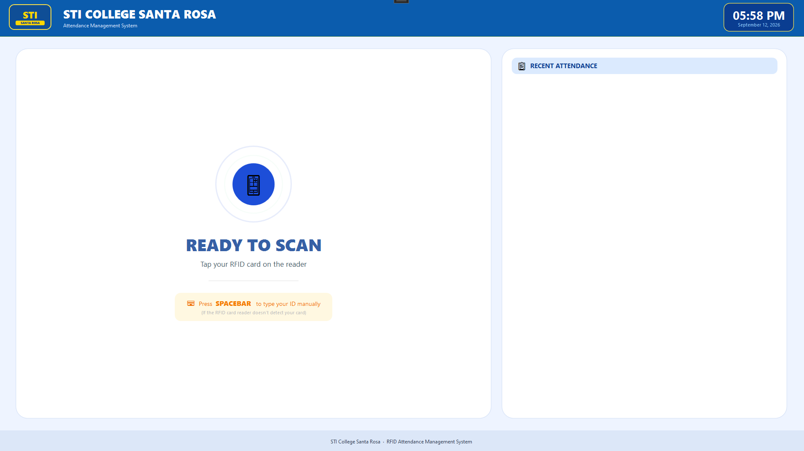
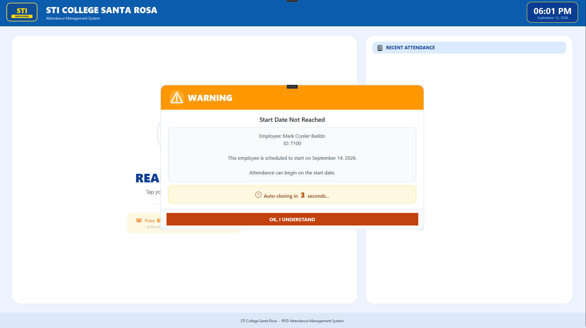
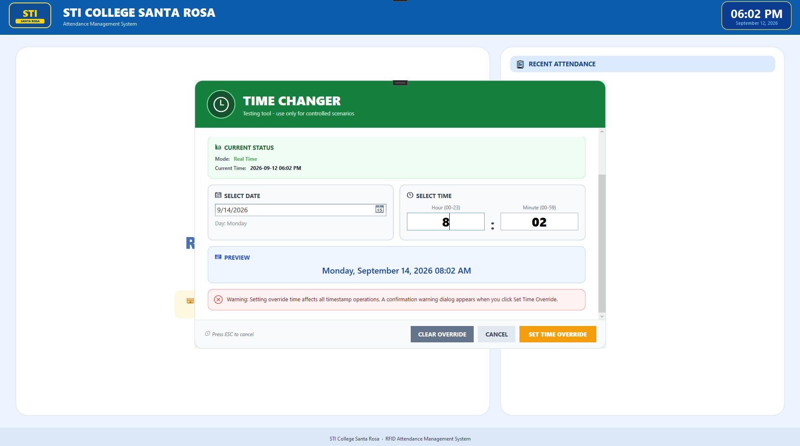
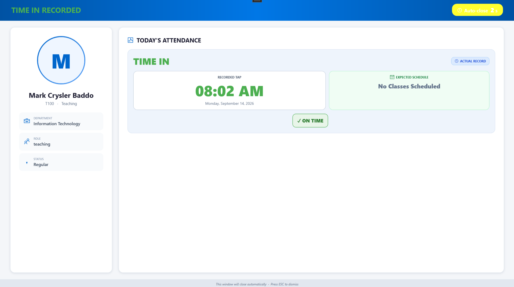
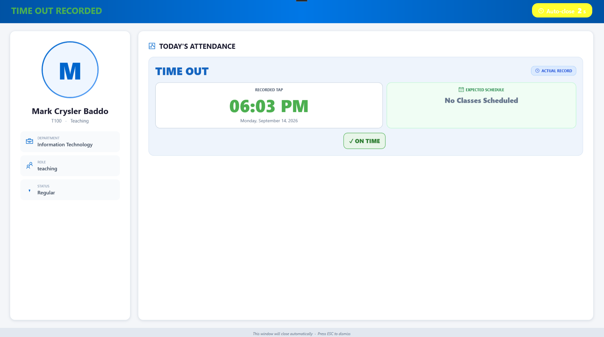

# STIRAMS WPF

A Windows RFID kiosk that records employee attendance locally and synchronizes it with the STIRAMS dashboard.

**Windows** · **Institutional Project** · 2026

[Portfolio](https://kuraisler.xyz)

## Purpose

STIRAMS WPF captures the attendance events that the web dashboard manages. Employees tap an RFID card at a Windows terminal, receive immediate feedback, and have their attendance checked against schedules and related rules. Local storage allows the kiosk to retain records when its database connection is unavailable.

## Intended users

Faculty and employees clocking in or out, plus campus staff operating the attendance terminals at STI College Santa Rosa.

## Main capabilities

- Read RFID card input and show the employee profile and attendance result.
- Validate taps against schedules, holidays, leave, and substitution rules.
- Store attendance locally and synchronize pending records in the background.
- Provide kiosk screens, reader detection, and diagnostic tools for operators.

## How it was built

### Windows client

C# and WPF on .NET 8 implement the kiosk screens. View models and dedicated services separate display logic from attendance processing.

### Offline data flow

SQLite holds local records and cached schedules. Background synchronization sends pending attendance to the shared PostgreSQL database.

### Reader and database integration

RFID input and Windows device detection connect the terminal to readers. Dapper and Npgsql handle database access; Material Design components style the interface.

## Technology stack

| Responsibility | Technologies |
| --- | --- |
| Windows application | C#, .NET 8, WPF, CommunityToolkit.Mvvm |
| Storage & sync | SQLite, PostgreSQL, Dapper, Npgsql |
| Interface & hardware | MaterialDesignThemes, WMI, USB RFID input |

## Project scope and current state

The desktop component of the STIRAMS institutional project. It requires Windows, a compatible RFID reader, and the configured shared database. Offline capture depends on the local employee and schedule cache.

## Source guide

- [`RAMSOfficial/Services/`](RAMSOfficial/Services/)
- [`RAMSOfficial/ViewModels/`](RAMSOfficial/ViewModels/)
- [`RAMSOfficial/TapInWindow.xaml.cs`](RAMSOfficial/TapInWindow.xaml.cs)

## Development setup

Requires Windows, the .NET 8 SDK, a compatible RFID reader, a local SQLite cache, and the configured shared PostgreSQL database. Review application settings and database services for your development environment. Open the project in Visual Studio to run or debug the kiosk.

```sh
dotnet restore RAMSOfficial/RAMSOfficial.csproj
dotnet build RAMSOfficial/RAMSOfficial.csproj
```

## Screenshots

<table>
<tr>
<td align="center"><br>Idle scanner state</td>
<td align="center"><br>Schedule enforcement</td>
</tr>
</table>

<details>
<summary>View all 5 screenshots</summary>

### 1. Idle scanner state


### 2. Schedule enforcement


### 3. QA testing tool



### 4. Time-in confirmation



### 5. Time-out confirmation



</details>

---

Project by [Mark Crysler Baddo](https://github.com/Kuraisura) · [Portfolio](https://kuraisler.xyz)
